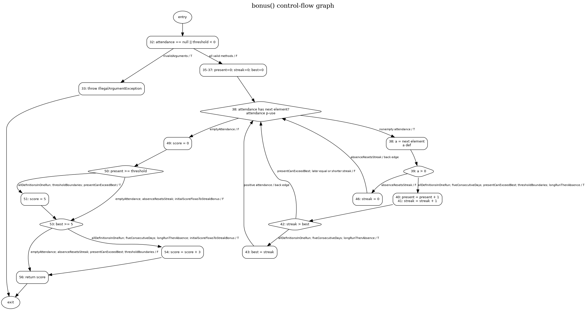

# Лаборатори №10 — Өгөгдлийн урсгалын тест, DU хосууд

**Оюутны нэр:** Д. Дэлгэрмаа  
**Оюутны код:** B232270035

Орчны гаралт (даалгаврыг гүйцэтгэсэн машинаас):

```text
$ java -version
openjdk version "21.0.13" 2026-10-20
OpenJDK Runtime Environment (build 21.0.13+9-Debian-1deb13u2)
OpenJDK 64-Bit Server VM (build 21.0.13+9-Debian-1deb13u2, mixed mode, sharing)

$ mvn -version
Apache Maven 3.9.9
Maven home: /usr/share/maven
Java version: 21.0.13, vendor: Debian, runtime: /usr/lib/jvm/java-21-openjdk-amd64
Default locale: en, platform encoding: UTF-8
OS name: "linux", version: "6.12.117+deb13-amd64", arch: "amd64", family: "unix"
```

## A. gcd — DU хүснэгт ба тест

Файлын мөрийн дугаарлалт хэрэглэв. `c-use` нь тооцоолол/буцаалтын хэрэглээ, `p-use` нь нөхцөлийн хэрэглээ. `T`/`F` нь тухайн нөхцөлийн салаа.

| Хувьсагч | Def мөр | Use мөр | Төрөл, салаа | Def-clear зам | Тестийн ID | Хамрагдсан |
|---|---:|---:|---|---|---|---|
| x | 13 | 16 | c-use | 13→15(T)→16 | GCD-12-8 | Тийм |
| x | 17 | 16 | c-use | 17→18→15(T)→16 | GCD-12-8, GCD-0-5 | Тийм |
| x | 13 | 20 | c-use | 13→15(F)→20 | GCD-7-0 | Тийм |
| x | 17 | 20 | c-use | 17→18→15(F)→20 | GCD-12-8, GCD-0-5 | Тийм |
| y | 13 | 15 | p-use T/F | 13→15 | GCD-7-0, GCD-12-8 | Тийм |
| y | 13 | 17 | c-use | 13→15(T)→16→17 | GCD-12-8, GCD-0-5 | Тийм |
| y | 18 | 15 | p-use T/F | 18→15 | GCD-12-8, GCD-0-5 | Тийм |
| y | 18 | 17 | c-use | 18→15(T)→16→17 | GCD-12-8, GCD-0-5 | Тийм |
| tmp | 16 | 18 | c-use | 16→17→18 | GCD-12-8, GCD-0-5 | Тийм |

`gcd(7,0)` давталт алгасдаг тул анхны `x`-ийн 20-р мөрийн хэрэглээг гаргах цорын ганц тест. `gcd(12,8)` биеийг хоёр удаа ажиллуулна: `(12,8)→(8,4)→(4,0)`. Ингэснээр 17-р мөрийн `x` болон 18-р мөрийн `y` дараагийн давталтад хэрэглэх DU замууд гарна. `tmp` зөвхөн 18-р мөрөнд уншигдана.

## B. bonus — CFG, def/use, DU хосууд

### B1. CFG



Зурагт 38-р мөрийн for-each нөхцөлийг массивт дараагийн элемент байгаа эсэхээр, `a` хувьсагчид дараагийн элементийг оноох алхмыг тусад нь үзүүлэв. Ирмэг бүр дээр түүнийг дайрдаг тестийн методын ID-г бичсэн.

### B2. Мөр тус бүрийн def/use

| Мөр | Definition | Use |
|---:|---|---|
| 31 | — | `attendance`, `threshold` параметрүүд бий болно |
| 32 | — | `attendance` p-use (null эсэх); short-circuit нөхцөл биелсэн үед `threshold` p-use (`< 0`) |
| 33 | — | Алдаа үүсгэнэ, параметрийн шинэ use байхгүй |
| 35 | `present` | — |
| 36 | `streak` | — |
| 37 | `best` | — |
| 38 | `a` (дараагийн элемент); давталтын нөхцөл | `attendance` p-use (дараагийн элемент байгаа эсэх) |
| 39 | — | `a` p-use (`> 0`) |
| 40 | `present` | `present` c-use (нэмэхийн баруун тал) |
| 41 | `streak` | `streak` c-use (нэмэхийн баруун тал) |
| 42 | — | `streak`, `best` p-use (`>`) |
| 43 | `best` | `streak` c-use |
| 46 | `streak` | — |
| 49 | `score` | — |
| 50 | — | `present`, `threshold` p-use (`>=`) |
| 51 | `score` | — |
| 53 | — | `best` p-use (`>=`) |
| 54 | `score` | `score` c-use (нэмэхийн баруун тал) |
| 56 | — | `score` c-use |

### B3. Def-clear DU хүснэгт

Хүснэгтэд ижил def/use мөртэй салаануудыг нэгтгэнэ. Давталтын үед “дараагийн итерац” замаар def-clear нөхцөлийг шалгасан.

| Хувьсагч | Def мөр | Use мөр | Use төрөл/салаа | Def-clear замын тайлбар | Тестийн ID | Хамрагдсан |
|---|---:|---:|---|---|---|---|
| attendance | 31 | 32 | p-use, true/false | null шалгалт | invalidArguments | Тийм |
| attendance | 31 | 38 | p-use, true/false | давталт хоосон эсвэл элемент унших | emptyAttendance, absenceResetsStreak, allDefinitionsInOneRun | Тийм |
| threshold | 31 | 32 | p-use, `<0` true/false | null биш үед short-circuit-ийн 2 дахь operand | invalidArguments, emptyAttendance | Тийм |
| threshold | 31 | 50 | p-use, `>=` true/false | давталтын дараа | allDefinitionsInOneRun, emptyAttendance, presentCanExceedBest, thresholdBoundaries | Тийм |
| a | 38 | 39 | p-use, true/false | элемент бүрд оноогоод шууд шалгана | allDefinitionsInOneRun, absenceResetsStreak | Тийм |
| present | 35 | 40 | c-use | эхний эерэг элементэд уншаад дахин тодорхойлно | allDefinitionsInOneRun | Тийм |
| present | 35 | 50 | p-use, true/false | хоосон эсвэл зөвхөн тасалсан өдөртэй зам | emptyAttendance | Тийм |
| present | 40 | 40 | c-use | дараагийн эерэг итерацад | allDefinitionsInOneRun | Тийм |
| present | 40 | 50 | p-use, true/false | эцсийн тоог threshold-той харьцуулна | allDefinitionsInOneRun, presentCanExceedBest | Тийм |
| streak | 36 | 41 | c-use | эхний эерэг өдөрт | allDefinitionsInOneRun | Тийм |
| streak | 36 | 42 | p-use, true/false | эхний эерэг өдөрт харьцуулна | allDefinitionsInOneRun | Тийм |
| streak | 41 | 41 | c-use | дараагийн эерэг өдөрт | allDefinitionsInOneRun | Тийм |
| streak | 41 | 42 | p-use, true/false | дараагийн эерэг өдрийн дараа | allDefinitionsInOneRun, presentCanExceedBest | Тийм |
| streak | 46 | 41 | c-use | тасалсны дараах эерэг өдөр; RHS уншилт нь дахин def хийхээс өмнө | absenceResetsStreak | Тийм |
| best | 37 | 42 | p-use, true/false | эхний эерэг өдөрт streak-тэй харьцуулна | allDefinitionsInOneRun | Тийм |
| best | 37 | 53 | p-use, true/false | нэг ч def 43 хүрээгүй хоосон/богино оролт | emptyAttendance, thresholdBoundaries | Тийм |
| best | 43 | 42 | p-use, true/false | best шинэчилсний дараах дараагийн эерэг өдөр | allDefinitionsInOneRun, presentCanExceedBest | Тийм |
| best | 43 | 53 | p-use, true/false | давталтын дараах уртын шалгалт | fiveConsecutiveDays, longRunThenAbsence | Тийм |
| score | 49 | 54 | c-use | мөр 50 худал, мөр 53 үнэн үед л завсрын оноог нэмнэ | `initialScoreFlowsToStreakBonus` нь мөр 50 худал, 53 үнэн замаар хамарна | Тийм |
| score | 49 | 56 | c-use | 50 ба 53-р мөр хоёулаа худал байх зам | emptyAttendance | Тийм |
| score | 51 | 54 | c-use | ирц босгыг хангаад, таван дараалалтай үед | allDefinitionsInOneRun | Тийм |
| score | 51 | 56 | c-use | мөр 53 худал тул дараагийн def үгүй | thresholdBoundaries | Тийм |
| score | 54 | 56 | c-use | нэмэлт оноо бодсоны дараа буцаах | allDefinitionsInOneRun, fiveConsecutiveDays | Тийм |

Мөр 46 дахь `streak=0` нь мөр 41 дэх хуучин `streak`-ийн бүх утгыг kill хийнэ. Дараагийн элемент ирэхэд мөр 41-ийн `streak = streak + 1`-ийн RHS уншилт нь мөр 46-ын def-ийг хүрч болно; үүний дараа мөр 41 шинэ def хийдэг. Харин `streak`-ийн мөр 46 def-ээс мөр 42-ын use хүртэл def-clear зам **байхгүй**: эерэг дараагийн элемент мөр 41-д дахин def хийгээд kill хийнэ; тасалсан элемент мөр 42-ыг алгасна. Тиймээс энэ def–use хос DU хүснэгтэд орохгүй.

Биелэшгүй салаа: мөр 32-ын `threshold < 0`-ийн хариуг `attendance == null` үед тусад нь авах боломжгүй. Java `||` short-circuit тул null бол хоёр дахь operand үнэлэгдэхгүй; харин null биш үед `<0` салааны хоёр утгыг тестэлж болно. For-each-ийн мөр 38 true салаа хоосон биш массивтай, false салаа давталт дуусахад гарна; хоёулаа биелнэ.

### B4. Алхамчилсан тест ба JaCoCo

All-defs-д **1 bonus тест** (`allDefinitionsInOneRun`) хангалттай. `[1,1,1,1,1]`, threshold 5 оролт нэг гүйцэтгэлдээ present-ийн мөр 35 ба 40, streak-ийн 36 ба 41, best-ийн 37 ба 43, score-ийн 49, 51 ба 54 def бүрийг дараагийн use-д хүргэнэ. Үүнээс цөөн нь тэг тест болох тул боломжгүй. Энэ шатны бүх suite 4 тест (3 gcd + 1 bonus) ажиллуулж, амжилттай дууссан. Үр дүн: [mvn-verify-alldefs.txt](results/mvn-verify-alldefs.txt), [jacoco-alldefs.csv](results/jacoco-alldefs.csv). Class мөрөнд branch **10 covered / 6 missed = 10/16**; all-defs хангагдсан ч branch 100% биш байна.

Эцсийн suite 12 тестээр амжилттай, branch **16/16**. Эцсийн `LINE_MISSED=1` (23/24 хамрагдсан) нь зөвшөөрсөн 7-р мөрийн далд constructor. Branch 100% байсан ч DU хос дутуу байж болдгийн жишээ: мөр 50-ын true/false ба мөр 53-ын true/false салааг тус тусын тестээр хамруулсан ч present<threshold бөгөөд best<5 болсон нэг ч тестгүй бол `score`-ийн 49→56 DU хос хүрэхгүй. Энэ хосыг emptyAttendance тестээр авсан. JaCoCo салааны үр дүнг харуулдаг болохоос def-ээс use хүртэлх өгөгдлийн урсгалыг хэмждэггүй.

Үр дүн: [mvn-verify-final.txt](results/mvn-verify-final.txt), [jacoco-final.csv](results/jacoco-final.csv). CSV-д `BRANCH_MISSED=0`, `BRANCH_COVERED=16`, `LINE_MISSED=1`, `LINE_COVERED=23`.

## C. Fault seeding

Мутаци тус бүрийг дангаар нь хийж `mvn test` ажиллуулаад эх кодыг starter хувилбараас сэргээсэн. `DataFlowTargets.java` одоо starter-тайгаа ижил.

| Мутаци | Үр дүн | Тестийн нэр / нотолгоо |
|---|---|---|
| M1 — мөр 41-ийн streak update устгасан | Баригдсан, 12 тестийн 4 assertion унав | `BonusTest.allDefinitionsInOneRun`, `BonusDuPairsTest.fiveConsecutiveDays`, `BonusDuPairsTest.longRunThenAbsence`: expected `<8>` but was `<5>` (шинэ `initialScoreFlowsToStreakBonus` дээр expected `<3>` but was `<0>`) |
| M2 — `best = streak`-ийг `best = present` болгосон | Баригдсан, 12 тестийн 1 assertion унав | `BonusDuPairsTest.absenceResetsStreak`: expected `<5>` but was `<8>`. Энэ оролтод present=5, streak=3; зөв код best=3 болгож нэмэлт 3 оноо өгөхгүй, харин буруу код best=5 болгоно. |
| M3 — ашиглагдаагүй `total = present + best` нэмсэн | Тест унаагүй, 12/12 амжилттай | [mvn-test-M3.txt](results/mvn-test-M3.txt) — үр дүнгийн утга өөрчлөгдөөгүй. Энэ нь dead definition бөгөөд гүйцэтгэлээр илрэхгүй; IDE-ийн static analysis “Variable 'total' is never used” төрлийн анхааруулгаар илрүүлэх ёстой. `javac` өөрөө unused local хувьсагчид анхааруулга гаргадаггүй. |

Дэлгэрэнгүй гаралт: [M1](results/mvn-test-M1.txt), [M2](results/mvn-test-M2.txt), [M3](results/mvn-test-M3.txt).

## Дүгнэлт

DU анализ нь тухайн утгыг хаана тодорхойлж, хаана хэрэглэж байгааг холбодог учраас зөв branch салааг дайрсан эсэхээс илүү мэдээлэл өгдөг. Branch хамралт өндөр байсан ч тодорхой def-ээс use хүрсэн эсэхийг батлахгүй. DU хүснэгтээр хувьсагчийн дахин тодорхойлолт хуучин утгыг kill хийж байгааг тодорхой харж болно. Харин бүх DU хосыг гараар гаргах нь branch тоолохоос илүү цаг их шаарддаг. Давталтын зам бүрд def-clear эсэхийг бодох нь хамгийн их анхаарал шаардсан хэсэг байлаа. Fault seeding нь хамралтын тоо өндөр байлаа ч буруу өгөгдөл ашиглах болон үхсэн def-ийн ялгааг харуулсан. JaCoCo branch тайланг баталгаажуулахад хэрэгтэй ч DU хүснэгтийг орлохгүй.

## AI туслахын хэрэглээ

AI туслахыг DU хүснэгтийн эхний хувилбар, тестийн санаа, тайлангийн найруулгад ашигласан. Хүснэгт, тестийн хүлээгдэж буй үр дүн, fault-seeding-ийн тоонуудыг бодитоор `mvn` ажиллуулж шалган зассан.
